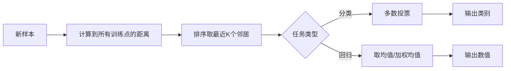

# KNN：K 近邻

[仓库首页](../README.md) · [本主题目录](README.md) · [上一篇：模型评估与拟合](03-模型评估与拟合.md) · [下一篇：线性回归](05-线性回归.md)

> 单模型 · 从距离、投票和 K 值理解非参数模型

KNN（K-Nearest Neighbors）是一种**懒惰学习**的监督学习算法——无显式训练过程，预测时通过"近朱者赤"的思路：找到与待测样本最近的 K 个邻居，用多数表决（分类）或均值（回归）来决定结果。

## 定义与核心思想

- **本质**：基于实例的学习，训练时仅存储数据，预测时才计算距离
- **核心思想**：相似样本在特征空间中彼此靠近
- **适用任务**：分类（多数投票）+ 回归（取均值/加权均值）

## 三要素

KNN 性能由三个基本要素决定：**距离度量、k 值、决策规则**。

### 距离度量

| 距离           | 公式                              | 适用场景                   |
| :------------- | :-------------------------------- | :------------------------- |
| 欧氏距离       | $`d = \sqrt{\sum(x_i - y_i)^2}`$    | 连续特征、低维数据（默认） |
| 曼哈顿距离 | $`d=\sum_i\lvert x_i-y_i\rvert`$ | 高维、稀疏数据、网格状 |
| 闵可夫斯基距离 | $`d=(\sum_i\lvert x_i-y_i\rvert^p)^{1/p}`$ | $`p=1`$ 为曼哈顿距离，$`p=2`$ 为欧氏距离 |
| 切比雪夫距离 | $`d=\max_i\lvert x_i-y_i\rvert`$ | 关注最大单维差异 |
| 余弦相似度     | $`\cos\theta`$                      | 文本分类、推荐系统         |
| 汉明距离       | —                                 | 类别特征                   |

> ⚠️ **必须先特征标准化**——否则量纲大的特征会主导距离计算。

### K 值选择

| K 值   | 模型复杂度 | 影响                                             |
| :----- | :--------- | :----------------------------------------------- |
| K 太小 | 高（复杂） | 对噪声敏感，易过拟合（K=1 时一个噪声点就能带偏） |
| K 太大 | 低（简单） | 决策边界过于平滑，易欠拟合                       |

**选择方法**：
- 交叉验证选最优 K（最常用，GridSearchCV）
- 经验法则：$`K=\sqrt{n}`$（n 为样本数）
- 二分类选**奇数 K**，避免投票平局
- 一般 K ≤ 20

### 分类决策规则

- **多数表决**（默认）：K 个邻居中出现最多的类别
- **加权投票**：距离越近权重越大（如 $`w_i = 1/d_i`$ 或高斯核）
- 多数表决等价于**经验风险最小化**

## 算法流程



## 优缺点对比

| 维度     | 优点                                    | 缺点                           |
| :------- | :-------------------------------------- | :----------------------------- |
| **原理** | 简单直观、易理解、理论成熟              | 无法给出数据内在含义           |
| **训练** | 无训练阶段（懒惰学习），训练复杂度 O(1) | —                              |
| **预测** | —                                       | 预测慢 O(N·D)，需计算到所有点  |
| **存储** | —                                       | 需存储全部训练数据，内存开销大 |
| **数据** | 无数据分布假设、可处理非线性            | 对样本不平衡敏感；维度灾难     |
| **任务** | 分类+回归通用、可处理数值和类别数据     | 高维大数据集效率低             |
| **抗噪** | 对异常值相对不敏感（K 较大时）          | K 小时对噪声极敏感             |

## 适用场景

- **强可解释性**需求：贷款审批、医疗诊断、用户分层
- **类域交叉或重叠**较多的数据集（比全局判别方法更优）
- **中小规模数据**、**低维特征**的分类回归任务
- 推荐系统、模式识别、手写数字识别

## 优化技术

| 技术                  | 原理                                      | 适用               |
| :-------------------- | :---------------------------------------- | :----------------- |
| **KD-Tree**           | 对训练数据分层索引，快速排除整个空间区域  | 低维数据（D < 20） |
| **Ball-Tree**         | 用嵌套超球面组织数据                      | 高维数据（D > 20） |
| **近似最近邻（ANN）** | Annoy、FAISS、HNSW 等，牺牲少量精度换速度 | 大规模、向量数据库 |
| **加权 KNN**          | 近邻权重大，远邻权重小                    | 噪声数据、精细边界 |
| **剪辑/压缩**         | 去除对分类作用不大的样本                  | 样本冗余数据       |

优化后单次查询可从 $`O(N)`$ 降至 $`O(\log N)`$。

## 代码实现要点

```python
from sklearn.neighbors import KNeighborsClassifier
from sklearn.preprocessing import StandardScaler
from sklearn.model_selection import train_test_split, GridSearchCV

# 1. 划分（防止数据泄漏：scaler 仅 fit 训练集）
X_train, X_test, y_train, y_test = train_test_split(X, y, test_size=0.2, stratify=y)

# 2. 特征标准化（KNN 对尺度敏感，必须做）
scaler = StandardScaler()
X_train_scaled = scaler.fit_transform(X_train)
X_test_scaled = scaler.transform(X_test)

# 3. 建模（algorithm='auto' 自动选 kd_tree/ball_tree）
knn = KNeighborsClassifier(n_neighbors=5, weights='uniform', algorithm='auto')

# 4. 交叉验证 + 簿格搜索调 K
param_grid = {'n_neighbors': range(3, 22, 2), 'weights': ['uniform', 'distance']}
grid = GridSearchCV(knn, param_grid, cv=5).fit(X_train_scaled, y_train)
```

**关键参数**：
- `n_neighbors`：K 值
- `weights`：`'uniform'`（等权）或 `'distance'`（距离倒数加权）
- `algorithm`：`'auto'`/`'kd_tree'`/`'ball_tree'`/`'brute'`
- `metric`：默认 `'minkowski'`（p=2 即欧氏）

***

## 速记口诀

| 要点   | 一句话                                    |
| :----- | :---------------------------------------- |
| 本质   | 懒惰学习，无训练，预测时才算距离          |
| 三要素 | 距离度量 + K 值 + 决策规则                |
| K 值   | 小→过拟合，大→欠拟合，交叉验证选最优      |
| 前提   | 特征必须标准化                            |
| 痛点   | 预测慢 O(N)、存储大、维度灾难、样本不平衡 |
| 优化   | KD-Tree/Ball-Tree/ANN/加权投票            |

---

[仓库首页](../README.md) · [本主题目录](README.md) · [上一篇：模型评估与拟合](03-模型评估与拟合.md) · [下一篇：线性回归](05-线性回归.md)
