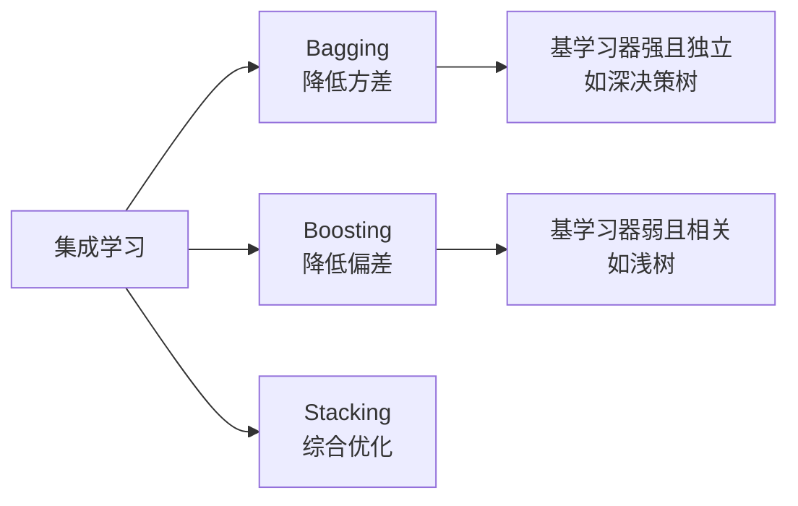

# 集成学习概览

[仓库首页](../README.md) · [本主题目录](README.md) · [上一篇：决策树](07-决策树.md) · [下一篇：随机森林 Random Forest](09-随机森林.md)

> 集成方法 · Bagging、Boosting、Stacking 与偏差方差

集成学习的核心思想是"**三个臭皮匠，顶个诸葛亮**"——通过构建并组合多个基学习器，让性能平平的弱模型组合成强大的强模型，本质是通过**降低方差或偏差**来提升泛化能力。

## 定义与核心思想

- **本质**：组合多个基学习器 → 提升整体性能
- **有效性根基**：偏差-方差权衡 + 大数定律（独立模型误差相互抵消）
- **多样性是灵魂**：基学习器差异越大，集成收益越高
- **两大思想流派**：
  - **并行化**：基学习器独立训练（Bagging）
  - **串行化**：基学习器有依赖，后一个纠错前一个（Boosting）

## 三大框架对比

| 维度         | Bagging（装袋法）          | Boosting（提升法）          | Stacking（堆叠法）         |
| :----------- | :------------------------- | :-------------------------- | :------------------------- |
| **结构**     | 并行（独立训练）           | 串行（后模型纠前模型错）    | 层次（两层结构）           |
| **数据使用** | 有放回抽样生成多子集       | 全量数据，调整样本权重/残差 | 原始数据→基模型输出→元模型 |
| **主攻方向** | **降低方差**（防过拟合）   | **降低偏差**（提升精度）    | 综合提升（挖掘模型互补）   |
| **基学习器** | 强学习器（如深决策树）     | 弱学习器（如浅树）          | 异构模型（不同算法）       |
| **结果聚合** | 投票（分类）/平均（回归）  | 加性组合（权重由具体方法决定）    | 元学习器学习如何加权       |
| **代表算法** | 随机森林                   | AdaBoost、GBDT、XGBoost     | StackingClassifier         |
| **类比**     | 多个医生独立诊断，多数表决 | 错题本：反复错的题加权重    | 专家写报告，总裁做最终决策 |

## 代表算法对比

| 算法            | 框架     | 基学习器            | 核心机制                          | 特点                                         |
| :-------------- | :------- | :------------------ | :-------------------------------- | :------------------------------------------- |
| **随机森林 RF** | Bagging  | 决策树（分类/回归） | Bootstrap 采样 + **特征随机选择** | 双重随机性增加多样性，降低树之间的相关性，仍需控制模型复杂度 |
| **AdaBoost**    | Boosting | 弱分类器（如浅树）  | **提高错分样本权重**，加权投票    | 自适应加权，对噪声和异常点较敏感             |
| **GBDT**        | Boosting | **回归树**（CART）  | **拟合负梯度**（残差），串行累加  | 用一阶导数，支持多种损失函数                 |
| **XGBoost**     | Boosting | CART/线性分类器     | **二阶泰勒展开** + 正则化         | 提供高效实现，支持采样、缺失值处理       |

**XGBoost 对 GBDT 的改进**：
1. 损失函数用**二阶导数**（GBDT 只用一阶）
2. 支持**线性分类器**，不限于树
3. 引入**正则化**防过拟合
4. 支持**数据采样**（类似随机森林）
5. 自动学习**缺失值处理**策略

## 偏差-方差权衡

| 集成方法 | 解决的问题       | 数学直觉                        |
| :------- | :--------------- | :------------------------------ |
| Bagging  | 高方差（过拟合） | N 个独立模型平均后方差降为 σ²/N |
| Boosting | 高偏差（欠拟合） | 串行纠错，逐步逼近真实函数      |
| Stacking | 综合优化         | 元模型学习基模型间的互补模式    |

> **核心洞察**：Bagging 适合"**太敏感**"模型（高方差如深树）；Boosting 适合"**太弱**"模型（高偏差如浅树）

## 优缺点与适用场景

| 优点                       | 缺点                         |
| :------------------------- | :--------------------------- |
| 提升预测精度和泛化能力     | 训练成本高、内存占用大       |
| 增强模型鲁棒性、抗过拟合   | 可解释性差（黑盒）           |
| 改善对噪声和异常值的稳定性 | 调参复杂                     |
| 可并行训练（Bagging）      | 推理速度慢，不适合低延迟场景 |

**适用场景**：数据量适中、精度要求高、竞赛夺冠、工业界鲁棒系统（金融风控、推荐、CTR 预估）

**不推荐场景**：数据量很小、实时性要求极高、解释性要求强、资源受限（边缘设备）、已有高性能单模型

## 速记口诀

| 要点                | 一句话                                                       |
| :------------------ | :----------------------------------------------------------- |
| 本质                | 组合多个基学习器，降低方差或偏差                             |
| 三框架              | Bagging(并行降方差)/Boosting(串行降偏差)/Stacking(分层综合)  |
| 代表算法            | RF(Bagging+树+特征随机)/AdaBoost(样本权重)/GBDT(拟合梯度)/XGBoost(二阶导+正则) |
| Bagging vs Boosting | 前者独立并行降方差，后者依赖串行降偏差                       |
| XGBoost vs GBDT     | 二阶导、正则、支持采样和缺失值、支持线性分类器               |
| 多样性              | 基学习器差异越大，集成收益越高                               |
| 选型                | 数据敏感用RF，精度要求高用XGBoost，竞赛用Stacking            |
| 不适用              | 数据太小、实时性高、解释性强、资源受限                       |

## 代码实现要点

算法初始化示例已分别放入随机森林、AdaBoost、GBDT、Voting 与 Stacking 章节。

**关键参数速查**：`n_estimators`（基学习器数）、`max_features`（特征采样）、`learning_rate`（Boosting 学习率）、`subsample`（样本采样）、`oob_score`（袋外评估）

> **调参经验**：Boosting 用 `n_estimators` + `learning_rate` 权衡（小学习率+多树）；RF 用 `max_features='sqrt'` 保证树间多样性

---

[仓库首页](../README.md) · [本主题目录](README.md) · [上一篇：决策树](07-决策树.md) · [下一篇：随机森林 Random Forest](09-随机森林.md)
