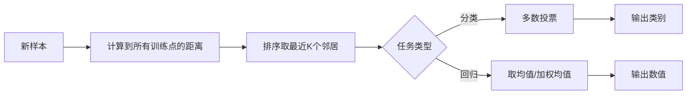
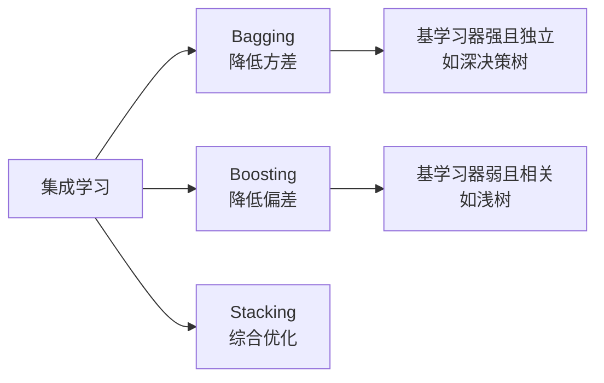

# 机器学习学习笔记

## 一、机器学习概念

机器学习是最经典的定义由人工智能先驱 **Arthur Samuel（亚瑟·萨缪尔）** 提出。

> **“Machine Learning is the field of study that gives computers the ability to learn without being explicitly programmed.”** *(机器学习是一个研究领域，它赋予计算机在没有被显式编程的情况下进行学习的能力。)* —— Arthur Samuel, 1959

**核心思想**：不通过人工编写具体的、硬编码的规则（if-else 逻辑）来解决问题，而是让算法从数据中自动寻找规律并提升性能。

## 二、机器学习算法分类

机器学习算法根据**训练数据是否带标签**以及**学习方式**的不同，主要分为四大类：监督学习、无监督学习、半监督学习和强化学习。其本质区别在于“训练信号从哪里来”——是来自人工标注的答案、数据本身的内在结构、少量标注加大量未标注，还是环境的奖励反馈。

| 对比维度     | 监督学习                               | 无监督学习             | 半监督学习                             | 强化学习                                |
| :----------- | :------------------------------------- | :--------------------- | :------------------------------------- | :-------------------------------------- |
| **数据特点** | 有明确标签                             | 无标签，只有特征       | 少量标注 + 大量未标注                  | 无标签，通过环境反馈                    |
| **学习信号** | 标准答案                               | 数据内部结构           | 少量答案 + 数据分布                    | 奖励/惩罚信号                           |
| **典型任务** | 分类、回归                             | 聚类、降维、关联规则   | 标签稀缺下的分类/回归                  | 序列决策、策略优化                      |
| **代表算法** | 线性/逻辑回归、SVM、随机森林、神经网络 | K-Means、PCA、Apriori  | 自训练、协同训练、图半监督、生成式模型 | Q-Learning、DQN、策略梯度、Actor-Critic |
| **适用场景** | 垃圾邮件识别、房价预测                 | 客户分群、特征压缩     | 医疗影像、文本分类                     | 游戏AI、机器人、自动驾驶                |
| **核心优点** | 目标明确、精度高                       | 无需标注、发现隐藏模式 | 节省标注成本、性能接近全监督           | 能处理动态环境、探索未知                |
| **核心缺点** | 依赖大量标注数据                       | 评估困难、解释性弱     | 假设依赖强、对数据质量敏感             | 训练时间长、样本效率低                  |

## 三、机器学习建模流程

### 1. 获取数据

#### 1. 目标

收集与机器学习任务相关、能够代表问题领域的"原材料"数据。

注意事项:

- **数据要全面、有代表性**：不能只采集某一类情况，避免采样偏差。
- **设定明确的采集范围**：不要"什么都想要"，避免引入噪声。
- **记录元数据**：来源、采集时间、采集方式，便于溯源。
- **初步去重**：明显重复的当场剔除。
- **合法合规**：确保数据来源合法，符合隐私法规。

### 2. 数据基本处理

#### 1. 目标

"去脏留清"，把原始数据整理成干净、规整、可被模型接受的格式。

#### 2. 具体操作

##### （1）缺失值处理

| 策略     | 适用场景                 | 方法                     |
| -------- | ------------------------ | ------------------------ |
| 删除     | 缺失比例高、关键字段缺失 | 删除含缺失值的行/列      |
| 填充     | 缺失较少                 | 均值、中位数、众数填充   |
| 插值     | 时序数据                 | 线性插值、拉格朗日插值   |
| 模型预测 | 缺失复杂、有强相关性     | 用 KNN、随机森林预测填充 |

##### （2）异常值处理

- **检测方法**：统计法（Z-score、3σ）、箱线图 IQR 法、可视化（散点图、箱线图）
- **处理方式**：直接删除、视为缺失值填充、分箱（将极端连续值转为离散类别）

##### （3）重复值处理

- 完全重复的行只保留一条，避免重复计算影响模型权重。

##### （4）格式标准化

- 统一日期、数字、单位的格式；文本统一编码（UTF-8）避免乱码。

#### 3. 数据集划分

> ⚠️ **数据泄漏警示**：必须**先划分训练集与测试集，再进行填充和标准化**。若先填充再划分，填充时可能用到测试集信息（如全局均值），导致测试集"污染"、评估结果虚高。

| 数据集 | 占比    | 作用                 |
| ------ | ------- | -------------------- |
| 训练集 | 60%~70% | 模型从中学习参数     |
| 验证集 | 15%~20% | 调整超参数、模型选择 |
| 测试集 | 15%~20% | 最终评估，仅用一次   |

划分原则：随机打散（避免时间/来源集中）、分层抽样（保证各类别比例一致）、测试集全程"不可见"。

### 3. 特征工程

#### 1. 定义

利用专业背景知识和技巧处理数据，把原始数据转换为更适合模型理解、能更好表示问题的特征形式，从而让算法效果最好。

> 原始数据如果不经处理直接喂给模型，效果往往令人不满意——好特征比复杂模型更能让性能翻倍。

#### 2. 五大子模块

##### （1）特征提取

从原始数据中提取与任务相关的特征，构成特征向量。

- **字典特征提取**：对类别型字典数据做 One-Hot
- **文本特征提取**：分词 → 去停用词 → 词干/词形还原 → TF-IDF / Word2Vec / 词袋模型
- **图像特征提取**：边缘检测、纹理特征；或用预训练 CNN（VGG、ResNet、ViT）提取深层特征
- **时间序列特征提取**：滞后特征、移动平均、季节性分解、周期性特征

##### （2）特征预处理

解决量纲（单位）问题，使不同特征对模型产生一致影响。

| 方法     | 公式                                                  | 适用场景                               |
| -------- | ----------------------------------------------------- | -------------------------------------- |
| 归一化 | $x_{\mathrm{norm}}=\dfrac{x-x_{\min}}{x_{\max}-x_{\min}}$，映射到 $[0,1]$ | 有明确边界的数据，如图像像素 |
| 标准化 | $x_{\mathrm{std}}=\dfrac{x-\mu}{\sigma}$，均值为 0、标准差为 1 | 对特征量纲敏感的模型，如 SVM、线性模型 |
| 对数变换 | $x\mapsto\log x$（要求 $x>0$） | 缓解右偏分布 |
| 类别编码 | One-Hot / Label Encoding                              | 将分类变量转为数值                     |

##### （3）特征降维

将高维数据降至低维，保留主要信息，降低计算复杂度、缓解过拟合。

- **PCA（主成分分析）**：线性变换，找到方差最大的正交方向
- **LDA（线性判别分析）**：有监督降维，最大化类间差异
- **t-SNE / UMAP**：非线性降维，多用于可视化
- **自编码器**：基于神经网络压缩

##### （4）特征选择

从已有特征中选择出最重要的子集，去除冗余和无关特征。

- **过滤法**：基于统计指标（相关性、卡方检验、互信息）筛选
- **包装法**：用模型（递归特征消除 RFE）迭代选择
- **嵌入法**：训练过程中自动选择，如 L1 正则化将不重要特征权重压缩为零

##### （5）特征组合

将多个特征组合成新特征，捕捉交互关系。

- **多项式特征**：例如 $x_1x_2,x_1^{2}$。
- **业务衍生特征**：例如从日期中提取星期、节假日、时段。

📖 特征选择 vs 特征降维 的区别

- **特征选择**：从原始特征中选子集，**保留原始特征的物理含义**，可解释性强。
- **特征降维**：通过线性/非线性变换生成全新的低维特征，**原始特征的含义被打破**，但保留了主要信息。降维后特征往往难以直接解释。

### 4. 机器学习（模型训练）

#### 1. 目标

选择合适的算法，用训练数据拟合模型参数，使其能对未知数据做出准确预测。

#### 2. 模型三要素

- **模型**：用参数描述特征与目标的关系，例如 $\hat y=w_1x_1+w_2x_2+b$。
- **策略**：选择最优模型的评价准则，例如最小化均方误差。
- **算法**：寻找最优参数的方法，例如梯度下降、最小二乘法。

#### 3. 选择算法的依据

- **监督学习**：分类（标签离散）→ 逻辑回归、SVM、决策树、随机森林、神经网络；回归（标签连续）→ 线性回归、岭回归、GBDT
- **无监督学习**：聚类 → K-Means、DBSCAN；降维 → PCA
- **半监督学习**：标签稀缺时
- **强化学习**：序列决策

#### 4. 训练过程

1. 初始化模型参数
2. 输入训练数据，前向计算预测值
3. 计算损失函数（Loss），衡量预测值与真实值差距
4. 反向传播计算梯度
5. 用优化器（SGD、Adam）更新参数
6. 重复迭代，直到 Loss 收敛或达到最大轮次

#### 5. 优化方法：交叉验证 + 超参数调优

| 调优方法     | 说明                                                         |
| ------------ | ------------------------------------------------------------ |
| K 折交叉验证 | 将训练集分成 K 份，轮流用 K-1 份训练、1 份验证，取平均；减少数据划分偶然性 |
| 网格搜索     | 遍历所有超参数组合，用交叉验证评估，选最优；开销大但全面     |
| 随机搜索     | 在参数空间随机采样，效率高于网格搜索                         |
| 贝叶斯优化   | 基于历史评估结果构建代理模型，智能选择下一组参数             |

过拟合 vs 欠拟合（必须理解的核心概念）

- **欠拟合**：模型过于简单，连训练集都没学明白，训练误差和测试误差都高。
  - 原因：特征太少、模型太简单、训练轮次不足
  - 解决：增加特征、换更复杂模型、延长训练
- **过拟合**：模型把训练集"背下来"了，训练误差极低，但测试误差高，泛化能力差。
  - 原因：模型太复杂、特征过多、训练数据少、训练轮次过多
  - 解决：正则化（L1/L2）、增加数据量、Dropout、Early Stopping、降低模型复杂度、特征选择

判别方法：观察**学习曲线**——训练误差和验证误差的差距。调参 vs 调优 的区别

- **调参**：调整模型内部的**超参数**，如学习率、决策树最大深度、正则化系数 λ、神经网络层数。超参数在训练前设定，不能通过数据自动学习。
- **调优**：更广义的概念，不仅包括调超参数，还包括换模型、改特征工程、调数据策略等所有提升性能的手段。

### 5. 模型评估

#### 1. 目标

用**未见过的测试集**检验模型的泛化能力，判断模型是否达到上线要求。

> ⚠️ 绝不能在训练数据上评估模型——它会"记住答案"而显得完美，但真实世界表现会很差。

#### 2. 分类任务评估指标

基于**混淆矩阵**：

|              | 预测为正     | 预测为负     |
| ------------ | ------------ | ------------ |
| **实际为正** | TP（真正例） | FN（假负例） |
| **实际为负** | FP（假正例） | TN（真负例） |

| 指标             | 公式             | 含义与适用场景                                     |
| ---------------- | ---------------- | -------------------------------------------------- |
| 准确率 Accuracy | $\dfrac{TP+TN}{TP+TN+FP+FN}$ | 整体正确率；类别不平衡时应结合其他指标 |
| 精确率 Precision | $\dfrac{TP}{TP+FP}$ | 预测为正中真正为正的比例；关注误报 |
| 召回率 Recall | $\dfrac{TP}{TP+FN}$ | 实际正例中被找出的比例；关注漏报 |
| F1 分数 | $\dfrac{2PR}{P+R}$ | 精确率与召回率的调和平均 |
| ROC-AUC          | —                | 衡量正负样本区分能力，对类别不平衡更稳健           |

#### 3. 回归任务评估指标

| 指标                | 公式                         | 含义                            |
| ------------------- | ---------------------------- | ------------------------------- |
| MAE（平均绝对误差） | $\dfrac1n\sum_{i=1}^{n}\lvert y_i-\hat y_i\rvert$ | 误差绝对值的平均 |
| MSE（均方误差） | $\dfrac1n\sum_{i=1}^{n}(y_i-\hat y_i)^2$ | 放大较大的误差 |
| RMSE（均方根误差） | $\sqrt{\mathrm{MSE}}$ | 与目标值同量纲 |
| $R^2$（决定系数） | $1-\dfrac{SS_{\mathrm{res}}}{SS_{\mathrm{tot}}}$ | 模型解释的方差比例；可为负值 |

#### 4. 评估方法

- **留出法**：直接划分训练集/测试集
- **K 折交叉验证**：将数据分为 K 份轮流验证，结果更稳健
- **留一法（LOOCV）**：K=N 的特例，计算成本高但数据利用率最大
- **分层采样**：保证各折中类别比例一致

#### 5. 结果决策

| 评估结果     | 行动                                                         |
| ------------ | ------------------------------------------------------------ |
| 达到业务要求 | 进入第 6 步：模型部署                                        |
| 未达到要求   | **回退**到第 2~4 步重新迭代：检查数据质量 → 优化特征 → 调整模型/超参数 |

## 四、模型拟合：欠拟合、过拟合与良好拟合

| 对比维度      | 欠拟合                 | 良好拟合                 | 过拟合                 |
| :------------ | :--------------------- | :----------------------- | :--------------------- |
| **通俗类比**  | "学不会"，复习太粗浅   | "学懂了"，举一反三       | "背题库"，死记硬背     |
| **训练误差**  | 高                     | 较低                     | 很低（甚至接近 0）     |
| **测试误差**  | 高                     | 较低                     | 显著高于训练误差       |
| **两者差距**  | 小（都很高）           | 小（都很低）             | 大（泛化间隙大）       |
| **偏差-方差** | 高偏差、低方差         | 偏差与方差适中           | 低偏差、高方差         |
| **根本原因**  | 模型容量不足           | 模型容量与数据复杂度匹配 | 模型容量过剩，记住噪声 |
| **解决方向**  | 增容量、加特征、减正则 | 维持当前状态             | 减容量、加数据、强正则 |

KNN（K-Nearest Neighbors）是一种**懒惰学习**的监督学习算法——无显式训练过程，预测时通过"近朱者赤"的思路：找到与待测样本最近的 K 个邻居，用多数表决（分类）或均值（回归）来决定结果。

***

## KNN 算法复习速记

### 一、定义与核心思想

- **本质**：基于实例的学习，训练时仅存储数据，预测时才计算距离
- **核心思想**：相似样本在特征空间中彼此靠近
- **适用任务**：分类（多数投票）+ 回归（取均值/加权均值）

### 二、三要素

KNN 性能由三个基本要素决定：**距离度量、k 值、决策规则**。

#### 1. 距离度量

| 距离           | 公式                              | 适用场景                   |
| :------------- | :-------------------------------- | :------------------------- |
| 欧氏距离       | $d = \sqrt{\sum(x_i - y_i)^2}$    | 连续特征、低维数据（默认） |
| 曼哈顿距离 | $d=\sum_i\lvert x_i-y_i\rvert$ | 高维、稀疏数据、网格状 |
| 闵可夫斯基距离 | $d=(\sum_i\lvert x_i-y_i\rvert^p)^{1/p}$ | $p=1$ 为曼哈顿距离，$p=2$ 为欧氏距离 |
| 切比雪夫距离 | $d=\max_i\lvert x_i-y_i\rvert$ | 关注最大单维差异 |
| 余弦相似度     | $\cos\theta$                      | 文本分类、推荐系统         |
| 汉明距离       | —                                 | 类别特征                   |

> ⚠️ **必须先特征标准化**——否则量纲大的特征会主导距离计算。

#### 2. K 值选择

| K 值   | 模型复杂度 | 影响                                             |
| :----- | :--------- | :----------------------------------------------- |
| K 太小 | 高（复杂） | 对噪声敏感，易过拟合（K=1 时一个噪声点就能带偏） |
| K 太大 | 低（简单） | 决策边界过于平滑，易欠拟合                       |

**选择方法**：
- 交叉验证选最优 K（最常用，GridSearchCV）
- 经验法则：$K = \sqrt{n}$（n 为样本数）
- 二分类选**奇数 K**，避免投票平局
- 一般 K ≤ 20

#### 3. 分类决策规则

- **多数表决**（默认）：K 个邻居中出现最多的类别
- **加权投票**：距离越近权重越大（如 $w_i = 1/d_i$ 或高斯核）
- 多数表决等价于**经验风险最小化**

### 三、算法流程



### 四、优缺点对比

| 维度     | 优点                                    | 缺点                           |
| :------- | :-------------------------------------- | :----------------------------- |
| **原理** | 简单直观、易理解、理论成熟              | 无法给出数据内在含义           |
| **训练** | 无训练阶段（懒惰学习），训练复杂度 O(1) | —                              |
| **预测** | —                                       | 预测慢 O(N·D)，需计算到所有点  |
| **存储** | —                                       | 需存储全部训练数据，内存开销大 |
| **数据** | 无数据分布假设、可处理非线性            | 对样本不平衡敏感；维度灾难     |
| **任务** | 分类+回归通用、可处理数值和类别数据     | 高维大数据集效率低             |
| **抗噪** | 对异常值相对不敏感（K 较大时）          | K 小时对噪声极敏感             |

### 五、适用场景

- **强可解释性**需求：贷款审批、医疗诊断、用户分层
- **类域交叉或重叠**较多的数据集（比全局判别方法更优）
- **中小规模数据**、**低维特征**的分类回归任务
- 推荐系统、模式识别、手写数字识别

### 六、优化技术

| 技术                  | 原理                                      | 适用               |
| :-------------------- | :---------------------------------------- | :----------------- |
| **KD-Tree**           | 对训练数据分层索引，快速排除整个空间区域  | 低维数据（D < 20） |
| **Ball-Tree**         | 用嵌套超球面组织数据                      | 高维数据（D > 20） |
| **近似最近邻（ANN）** | Annoy、FAISS、HNSW 等，牺牲少量精度换速度 | 大规模、向量数据库 |
| **加权 KNN**          | 近邻权重大，远邻权重小                    | 噪声数据、精细边界 |
| **剪辑/压缩**         | 去除对分类作用不大的样本                  | 样本冗余数据       |

优化后单次查询可从 $O(N)$ 降至 $O(\log N)$。

### 七、代码实现要点

```python
from sklearn.neighbors import KNeighborsClassifier
from sklearn.preprocessing import StandardScaler
from sklearn.model_selection import train_test_split, GridSearchCV

# 1. 划分（防止数据泄漏：scaler 仅 fit 训练集）
X_train, X_test, y_train, y_test = train_test_split(X, y, test_size=0.2, stratify=y)

# 2. 特征标准化（KNN 对尺度敏感，必须做）
scaler = StandardScaler()
X_train_scaled = scaler.fit_transform(X_train)
X_test_scaled = scaler.transform(X_test)

# 3. 建模（algorithm='auto' 自动选 kd_tree/ball_tree）
knn = KNeighborsClassifier(n_neighbors=5, weights='uniform', algorithm='auto')

# 4. 交叉验证 + 簿格搜索调 K
param_grid = {'n_neighbors': range(3, 22, 2), 'weights': ['uniform', 'distance']}
grid = GridSearchCV(knn, param_grid, cv=5).fit(X_train_scaled, y_train)
```

**关键参数**：
- `n_neighbors`：K 值
- `weights`：`'uniform'`（等权）或 `'distance'`（距离倒数加权）
- `algorithm`：`'auto'`/`'kd_tree'`/`'ball_tree'`/`'brute'`
- `metric`：默认 `'minkowski'`（p=2 即欧氏）

***

### 八、速记口诀

| 要点   | 一句话                                    |
| :----- | :---------------------------------------- |
| 本质   | 懒惰学习，无训练，预测时才算距离          |
| 三要素 | 距离度量 + K 值 + 决策规则                |
| K 值   | 小→过拟合，大→欠拟合，交叉验证选最优      |
| 前提   | 特征必须标准化                            |
| 痛点   | 预测慢 O(N)、存储大、维度灾难、样本不平衡 |
| 优化   | KD-Tree/Ball-Tree/ANN/加权投票            |

线性回归是监督学习中最基础的回归算法，核心是找一条直线（或超平面），使预测值 $\hat{y}$ 与真实值 $y$ 的**均方误差最小**，本质是参数 $w$ 的线性组合。

***

## 线性回归复习速记

### 一、模型形式

| 类型         | 公式                                              | 说明                           |
| :----------- | :------------------------------------------------ | :----------------------------- |
| 一元线性回归 | $\hat{y} = wx + b$                                | w 权重（斜率），b 偏置（截距） |
| 多元线性回归 | $\hat{y} = w_1x_1 + w_2x_2 + \cdots + w_nx_n + b$ | 多特征                         |
| 矩阵形式     | $\hat{y} = W^TX + b$（$x_0=1$ 吸收 b）            | 便于批量运算                   |

> "线性"指**参数 w 是线性**的，特征 x 可做多项式变换（如 $x^2$、$x_1x_2$）转化为非线性关系。

### 二、损失函数

$$
MSE = \frac{1}{m}\sum_{i=1}^{m}(y_i - \hat{y}_i)^2
$$

- **MSE**：放大较大误差，处处可导，对异常值敏感
- **MAE**：$|y-\hat{y}|$，对异常值不敏感，但 0 点不可导
- **Huber**：小误差用 MSE，大误差用 MAE，二者折中

> 概率依据：若假设误差服从**高斯分布**，则最大似然估计（MLE）等价于最小化 MSE。

### 三、两大求解方法

| 维度           | 正规方程（最小二乘法）            | 梯度下降                           |
| :------------- | :-------------------------------- | :--------------------------------- |
| **公式**       | $w = (X^TX)^{-1}X^Ty$             | $w := w - \alpha \nabla J(w)$      |
| **原理**       | 令梯度=0 直接求解析解             | 沿负梯度方向迭代逼近最小值         |
| **训练复杂度** | $O(n^3)$（矩阵求逆）              | $O(m \cdot n)$ 每次迭代            |
| **是否调参**   | 无需学习率                        | 需调学习率 α                       |
| **优点**       | 一步到位、精准、无迭代            | 通用、适合大数据、可扩展到深度学习 |
| **缺点**       | 特征多时极慢；$X^TX$ 不可逆时失效 | 需迭代；α 大震荡小龟速；需特征缩放 |
| **适用**       | 小数据集、特征数 < 10000          | 大数据集、高维特征                 |

### 四、正则化变体

当特征过多、共线性强、易过拟合时，在损失函数加惩罚项：

| 方法                    | 损失函数     | 惩罚项                                  | 特点                                   |
| :---------------------- | :----------- | :-------------------------------------- | :------------------------------------- |
| **线性回归（OLS）**     | $\verty-Xw\vert^2$ | 无                                      | 基础模型                               |
| **岭回归 Ridge**        | $\verty-Xw\vert^2$ | $\lambda\vertw\vert_2^2$                      | 权重整体趋小不归零，处理共线性，稳定   |
| **Lasso 回归**          | $\verty-Xw\vert^2$ | $\lambda\vertw\vert_1$                        | 权重可降为零，**自动特征选择**，稀疏解 |
| **弹性网络 ElasticNet** | $\verty-Xw\vert^2$ | $\lambda_1\vertw\vert_1 + \lambda_2\vertw\vert_2^2$ | 兼具稀疏与分组效应，处理强相关特征组   |

**L1 vs L2 本质区别**（几何解释）：
- **L1** 约束域为**菱形**，与损失等高线交点常在坐标轴上 → 系数**归零**（特征选择）
- **L2** 约束域为**圆形**，交点一般不在轴上 → 系数**缩小但不归零**

> λ 越大正则越强：λ 大→欠拟合；λ 小→过拟合。岭回归解析解 $w=(X^TX+\lambda I)^{-1}X^Ty$，加 λI 保证可逆。

### 五、模型假设（4 大经典假设）

1. **线性关系**：y 与 x 之间线性相关
2. **独立性**：误差项相互独立，无自相关（Durbin-Watson 检验）
3. **同方差性**：误差方差恒定（残差图检查）
4. **正态性**：误差服从正态分布（Q-Q 图、Shapiro-Wilk 检验）
5. **无多重共线性**：特征间不高度相关（VIF > 10 表示严重共线性）

### 六、优缺点与适用场景

| 优点                             | 缺点                                  |
| :------------------------------- | :------------------------------------ |
| 原理简单、易实现、训练快         | 只能建模线性关系，非线性需特征工程    |
| 可解释性强（权重反映特征重要性） | 对异常值敏感                          |
| 有解析解、理论成熟               | 假设条件严格（线性/独立/同方差/正态） |
| 是复杂模型的基础组件             | 特征多/共线性时易过拟合               |

**适用场景**：房价/销量/股价等连续值预测、特征与目标近似线性、需强可解释性的场景、作为回归基线模型。

### 七、评估指标

| 指标               | 公式                               | 含义                                                        |
| :----------------- | :--------------------------------- | :---------------------------------------------------------- |
| **MSE**            | $\frac{1}{m}\sum(y_i-\hat{y}_i)^2$ | 均方误差，对大误差敏感                                      |
| **RMSE**           | $\sqrt{MSE}$                       | 与 y 同量纲，直观                                           |
| **MAE**            | $\frac{1}{m}\sum\verty_i-\hat{y}_i\vert$ | 对异常值不敏感                                              |
| **R²（决定系数）** | $1 - \frac{SS_{res}}{SS_{tot}}$    | 模型解释的方差比例，越接近 1 越好；可为负（比均值预测还差） |

### 八、代码实现要点

```python
from sklearn.linear_model import LinearRegression, Ridge, Lasso, ElasticNet
from sklearn.preprocessing import StandardScaler
from sklearn.model_selection import train_test_split, GridSearchCV
from sklearn.metrics import mean_squared_error, r2_score

# 1. 划分 + 标准化（梯度下降必需，正规方程可选）
X_train, X_test, y_train, y_test = train_test_split(X, y, test_size=0.2, random_state=42)
scaler = StandardScaler()
X_train_s = scaler.fit_transform(X_train)
X_test_s = scaler.transform(X_test)

# 2. 建模（sklearn 默认用正规方程，fit_intercept=True）
model = LinearRegression().fit(X_train_s, y_train)

# 3. 正则化变体
ridge = Ridge(alpha=1.0)              # L2
lasso = Lasso(alpha=0.1)              # L1，注意 sklearn 用 alpha 而非 lambda
enet  = ElasticNet(alpha=0.1, l1_ratio=0.5)  # L1+L2

# 4. 调 λ（交叉验证）
grid = GridSearchCV(Ridge(), {'alpha':[0.01,0.1,1,10]}, cv=5).fit(X_train_s, y_train)

# 5. 评估
y_pred = model.predict(X_test_s)
print("MSE:", mean_squared_error(y_test, y_pred))
print("R²:", r2_score(y_test, y_pred))
print("权重:", model.coef_, "截距:", model.intercept_)
```

**关键参数**：`fit_intercept`（是否计算截距）、`alpha`（正则系数 λ）、`l1_ratio`（ElasticNet 中 L1 占比）。

***

### 九、速记口诀

| 要点 | 一句话                                                       |
| :--- | :----------------------------------------------------------- |
| 本质 | 最小化预测值与真实值的均方误差                               |
| 形式 | $\hat{y} = W^TX + b$，线性指参数线性                         |
| 求解 | 正规方程（小数据闭式解）vs 梯度下降（大数据迭代）            |
| 正则 | Ridge(L2 权重缩小) / Lasso(L1 特征选择) / ElasticNet(两者结合) |
| 假设 | 线性、独立、同方差、正态、无共线性                           |
| 评估 | MSE/RMSE/MAE/R²                                              |
| 前提 | 用梯度下降时必须特征缩放                                     |
| 痛点 | 只能线性、对异常值敏感、假设严格                             |

逻辑回归虽名带"回归"，实为**二分类算法**，核心是在线性回归输出 $z = w^Tx + b$ 上套一层 **Sigmoid 函数**压缩成概率，用**交叉熵损失**（等价于最大似然估计）训练。

***

## 逻辑回归复习速记

### 一、定义与本质

| 维度                  | 说明                                                         |
| :-------------------- | :----------------------------------------------------------- |
| **任务**              | 分类（主要二分类，可扩展多分类）                             |
| **本质**              | 线性回归 + Sigmoid 激活 = 概率输出                           |
| **模型** | $P(y=1\mid x)=\sigma(w^Tx+b)=\dfrac{1}{1+e^{-z}}$ |
| **决策边界**          | 线性超平面 $\{x: w^Tx + b = 0\}$，概率≥0.5 判正类            |
| **对数几率（Logit）** | $\log\dfrac{P(y=1\mid x)}{P(y=0\mid x)}=w^Tx+b$，即对数几率是特征的线性组合 |

> **线性回归 → 逻辑回归**：线性回归输出 $(-\infty, +\infty)$，不能解释为概率；Sigmoid 压缩到 $(0,1)$ 才可解释为"属于正类的概率"。

### 二、Sigmoid 函数

$$
\sigma(z) = \frac{1}{1 + e^{-z}}, \quad z = w^Tx + b
$$

- **性质**：S 形曲线，将任意实数映射到 $(0,1)$；单调递增、平滑可微
- **导数简洁**：$\sigma'(z) = \sigma(z)(1 - \sigma(z))$
- **局限**：输入趋于 ±∞ 时梯度趋零（深层网络中易梯度消失）；含指数运算

### 三、损失函数：交叉熵（对数损失）

$$
L = -\frac{1}{m}\sum_{i=1}^{m}[y_i\log\hat{y}_i + (1-y_i)\log(1-\hat{y}_i)]
$$

| 真实值 y | 预测 ŷ | 损失                 |
| :------- | :----- | :------------------- |
| 1        | 接近 1 | 小（预测对且自信）   |
| 1        | 接近 0 | 极大（预测错且自信） |
| 0        | 接近 0 | 小                   |
| 0        | 接近 1 | 极大                 |

**关键性质**：
- 损失是**凸函数**，梯度下降必收敛到全局最优
- **MLE 等价性**：假设 y 服从伯努利分布，最大化似然 ↔ 最小化交叉熵
- 预测错误且自信时损失指数级增长，给模型强"纠错信号"

<details>
<summary>📖 为什么不用 MSE？</summary>

1. **MSE + Sigmoid 会导致损失函数非凸**，存在多个局部极小值，梯度下降难找全局最优
2. **梯度形式复杂**：MSE 对参数的偏导含 $\sigma'(z)$ 项，当预测接近 0 或 1 时梯度趋零，学习停滞
3. **概率依据缺失**：MSE 对应高斯假设，而分类标签服从伯努利分布，交叉熵才是 MLE 的自然产物

</details>

### 四、梯度下降求解

**梯度公式极其简洁**：

$$
\frac{\partial L}{\partial w_j} = \frac{1}{m}\sum_{i=1}^{m}(\hat{y}_i - y_i)x_{ij}, \quad w_j := w_j - \alpha \cdot (\hat{y} - y)x_j
$$

> **形式与线性回归梯度完全相同**，区别在于 $\hat{y}$ 经过了 Sigmoid 压缩。这个"预测值−真实值"的形式是**神经网络反向传播的基石**。

### 五、多分类扩展

| 策略        | OvR（One-vs-Rest）                        | Softmax（多项逻辑回归）     |
| :---------- | :---------------------------------------- | :-------------------------- |
| **原理**    | N 类训练 N 个二分类器，每类 vs 其他所有类 | 直接输出各类概率，和为 1    |
| **模型数**  | N 个                                      | 1 个                        |
| **优点**    | 实现简单、计算高效、适合类别多            | 保留类别间相关性，精度更高  |
| **缺点**    | 忽略类别间关系，类别不均衡时退化          | 类别极多时计算开销大        |
| **sklearn** | `multi_class='ovr'`（liblinear 默认）     | `multi_class='multinomial'` |
| **适用**    | 类别多、效率优先                          | 类别少、精度优先            |

> **Softmax 函数**：$\text{softmax}(z_i) = \frac{e^{z_i}}{\sum_k e^{z_k}}$，是 Sigmoid 在多分类下的自然推广，所有类别概率归一化为 1。

### 六、正则化

逻辑回归默认带正则化，sklearn 用 **C** 控制强度（C 是 λ 的倒数）：

| 参数      | 选项               | 效果                                                   |
| :-------- | :----------------- | :----------------------------------------------------- |
| `penalty` | `'l2'`（默认）     | 权重整体缩小，不归零，稳定                             |
|           | `'l1'`             | 权重归零，**特征选择**，稀疏解                         |
|           | `'elasticnet'`     | L1+L2 结合，兼顾稀疏与稳定                             |
|           | `None`             | 无正则化                                               |
| `C`       | 正浮点（默认 1.0） | **C 越小→正则越强→易欠拟合；C 越大→正则越弱→易过拟合** |

> `solver` 与正则化的匹配：liblinear 支持 L1/L2；lbfgs/newton-cg/sag 仅 L2；saga 支持 L1/L2/ElasticNet。

### 七、优缺点与适用场景

| 优点                                      | 缺点                               |
| :---------------------------------------- | :--------------------------------- |
| 简单高效、训练快、可并行                  | 假设线性决策边界，非线性需特征工程 |
| 输出概率，可解释性强（系数=对数几率变化） | 对异常值和多重共线性敏感           |
| 损失凸，全局最优解                        | 类别严重不平衡时表现差             |
| 是神经网络 Softmax 层的雏形               | 高维特征需正则化防止过拟合         |

**适用场景**：二分类基线模型、需概率输出和强可解释性的场景（金融风控、医疗诊断、点击率预估、垃圾邮件检测、疾病预测）。

### 八、评估指标

分类任务常用：
- **Accuracy**：整体正确率（类别平衡时）
- **Precision / Recall / F1**：不平衡数据必备
- **ROC-AUC**：衡量正负样本区分能力，对阈值不敏感
- **混淆矩阵**：可视化各类别对错情况

### 九、代码实现要点

```python
from sklearn.linear_model import LogisticRegression, LogisticRegressionCV
from sklearn.preprocessing import StandardScaler
from sklearn.model_selection import train_test_split, GridSearchCV

# 1. 划分 + 标准化（迭代优化必需，否则收敛慢或不稳）
X_tr, X_te, y_tr, y_te = train_test_split(X, y, test_size=0.2, stratify=y)
scaler = StandardScaler()
X_tr_s = scaler.fit_transform(X_tr)
X_te_s = scaler.transform(X_te)

# 2. 建模
model = LogisticRegression(
    penalty='l2',            # l1/l2/elasticnet/None
    C=1.0,                   # 正则强度倒数，越小越强
    solver='lbfgs',          # lbfgs/liblinear/saga/newton-cg/sag
    max_iter=100,
    class_weight='balanced', # 类别不平衡时自动加权
    multi_class='auto'       # auto/ovr/multinomial
).fit(X_tr_s, y_tr)

# 3. 调 C（交叉验证）
grid = GridSearchCV(LogisticRegression(penalty='l2'),
                    {'C':[0.01,0.1,1,10,100]}, cv=5, scoring='f1')

# 4. 输出
print("权重:", model.coef_, "截距:", model.intercept_)
print("概率:", model.predict_proba(X_te_s)[:5])  # 每行两类概率
print("类别:", model.predict(X_te_s)[:5])
```

**关键参数速查**：`penalty`（正则类型）、`C`（强度）、`solver`（求解器）、`class_weight`（类别平衡）、`multi_class`（多分类策略）、`max_iter`（最大迭代）。

***

### 十、速记口诀

| 要点     | 一句话                                            |
| :------- | :------------------------------------------------ |
| 本质     | 名为回归实为分类，线性回归+Sigmoid=概率           |
| 损失     | 交叉熵=对数损失，等价于 MLE，凸函数保证全局最优   |
| 不用 MSE | MSE+Sigmoid 非凸、梯度消失、概率依据不符          |
| 梯度     | $\hat{y} - y$，形式极简，是反向传播基石           |
| 多分类   | OvR（N 个二分类）vs Softmax（归一化概率）         |
| 正则     | C 越小正则越强；L1 稀疏特征选择，L2 稳定默认      |
| 前提     | 线性可分；需特征标准化；类别不平衡用 class_weight |
| 输出     | `predict_proba` 出概率，`predict` 出类别          |

决策树是一种基于**树形结构进行 if-else 决策**的算法，核心是用划分准则（信息增益/增益率/基尼系数）选择最优特征递归分裂数据，本质是贪心地降低节点不纯度，直到叶节点纯度达标。

***

## 决策树复习速记

### 一、定义与结构

- **结构**：根节点（全部数据）→ 内部节点（特征测试）→ 叶节点（类别/数值）
- **本质**：递归地选择最优特征划分数据集，让子节点越来越"纯"
- **核心三要素**：特征选择 + 决策规则 + 剪枝策略
- **特点**：无需特征标准化（分裂点不受数值缩放影响）、可处理非线性、天然支持混合类型特征

### 二、三大经典算法对比

| 维度          | ID3                      | C4.5                 | CART               |
| :------------ | :----------------------- | :------------------- | :----------------- |
| **划分准则**  | 信息增益                 | 信息增益率           | 基尼指数           |
| **树结构**    | 多叉树                   | 多叉树               | **二叉树**         |
| **任务**      | 分类                     | 分类                 | **分类 + 回归**    |
| **连续值**    | ✗                        | ✓                    | ✓                  |
| **缺失值**    | ✗                        | ✓                    | ✓                  |
| **剪枝**      | 无                       | 后剪枝               | 前/后剪枝          |
| **偏好/缺陷** | 偏向多取值特征，易过拟合 | 用增益率惩罚多值特征 | 二叉切分，计算高效 |
| **回归用**    | —                        | —                    | MSE 选特征         |

> 一句话：**ID3 信息增益→偏多值；C4.5 增益率→纠偏；CART 基尼+二叉→通用默认**

### 三、划分准则公式

| 准则           | 公式                                                         | 特点                                               |
| :------------- | :----------------------------------------------------------- | :------------------------------------------------- |
| **信息熵**     | $H(D) = -\sum_{k=1}^{\vertY\vert} p_k \log_2 p_k$                  | 衡量混乱度；纯时=0，等比例时最大                   |
| **信息增益**   | $Gain(D,a) = H(D) - \sum_v \frac{\vertD_v\vert}{\vertD\vert} H(D_v)$     | 熵下降量，越大越好；ID3 用                         |
| **信息增益率** | $Gain\_ratio(D,a) = \frac{Gain(D,a)}{IV(a)}$，$IV(a)=-\sum_v \frac{\vertD_v\vert}{\vertD\vert}\log_2\frac{\vertD_v\vert}{\vertD\vert}$ | 除以特征自身熵，惩罚多值；C4.5 用                  |
| **基尼指数**   | $Gini(D) = 1 - \sum_k p_k^2$                                 | 不用 log 计算更快；纯时=0，二分类最大 0.5；CART 用 |
| **基尼增益**   | $\Delta Gini = Gini(D) - \sum_v \frac{\vertD_v\vert}{\vertD\vert} Gini(D_v)$ | 越大越好                                           |

**熵 vs 基尼**：熵用 log 对离散敏感、计算稍慢；基尼用平方对连续敏感、计算快；sklearn 默认 `criterion='gini'`

### 四、剪枝策略

不限制的决策树会分裂到每个叶节点纯度=1，**必然过拟合**，剪枝是核心手段。

| 维度     | 预剪枝                       | 后剪枝                               |
| :------- | :--------------------------- | :----------------------------------- |
| **时机** | 构建过程中提前停止分裂       | 完整树生成后自底向上修剪             |
| **方法** | 限制深度/样本数/不纯度阈值   | CCP（代价复杂度）、REP（错误率降低） |
| **优点** | 训练快、效率高、防止过拟合   | 保留更多分支、欠拟合风险小、泛化更好 |
| **缺点** | 视野短浅，可能欠拟合         | 训练开销大、需验证集                 |
| **代表** | sklearn 默认（max_depth 等） | CART 的 CCP、C4.5 的悲观剪枝         |

**预剪枝常用停止条件**：`max_depth`（最大深度）、`min_samples_split`（节点分裂最少样本）、`min_samples_leaf`（叶节点最少样本）、`min_impurity_decrease`（最小不纯度下降）、`max_leaf_nodes`

### 五、优缺点与适用场景

| 优点                                 | 缺点                                    |
| :----------------------------------- | :-------------------------------------- |
| 可解释性强（if-else 规则，可可视化） | 极易过拟合（必须剪枝）                  |
| 无需特征标准化、能处理数值+类别特征  | 对训练数据敏感、方差大（小变化→不同树） |
| 能捕捉非线性决策边界                 | 贪心分裂不保证全局最优                  |
| 训练快、线性复杂度                   | 树过深时泛化差                          |

**适用场景**：风控、医疗诊断等需强可解释性场景；混合类型特征；非线性边界；作为随机森林/GBDT 的基学习器

### 六、sklearn 实现要点

```python
from sklearn.tree import DecisionTreeClassifier, plot_tree
from sklearn.model_selection import train_test_split, GridSearchCV

X_tr, X_te, y_tr, y_te = train_test_split(X, y, test_size=0.2, stratify=y)

clf = DecisionTreeClassifier(
    criterion='gini',         # gini/entropy/log_loss
    splitter='best',          # best/random
    max_depth=6,              # 关键防过拟合：常用 6-10
    min_samples_split=2,      # 节点分裂最少样本
    min_samples_leaf=6,       # 叶节点最少样本（推荐 5-20）
    max_features=None,        # 分裂时考虑的最大特征数
    max_leaf_nodes=None,      # 最大叶节点数
    min_impurity_decrease=0,  # 最小不纯度下降
    class_weight='balanced',  # 类别不平衡
    ccp_alpha=0.0,            # 代价复杂度剪枝强度
    random_state=42
).fit(X_tr, y_tr)

# 网格搜索调参
params = {'max_depth': range(3,10), 'min_samples_leaf': range(1,20)}
grid = GridSearchCV(clf, params, cv=5, scoring='accuracy').fit(X_tr, y_tr)

# 可视化
plot_tree(clf, filled=True, feature_names=...)
# 特征重要性
clf.feature_importances_
```

**关键参数速查**：`criterion`（划分准则）、`max_depth`（树高）、`min_samples_leaf`（叶大小）、`ccp_alpha`（后剪枝强度）、`class_weight`（类别平衡）

> **调参经验**：`max_depth` 控"高度"，`min_samples_leaf` 控"叶大小"，两者组合防过拟合效果最好；数据量大用预剪枝，噪声大/易过拟合用后剪枝（`ccp_alpha`）

***

### 七、速记口诀

| 要点     | 一句话                                                       |
| :------- | :----------------------------------------------------------- |
| 本质     | if-else 树，贪心降低节点不纯度                               |
| 三算法   | ID3 信息增益(偏多值) → C4.5 增益率(纠偏) → CART 基尼+二叉(通用) |
| 准则     | 熵(log,离散)vs 基尼(平方,快,连续)；增益=划分前后纯度差       |
| 剪枝     | 预剪枝(快,可能欠拟合)vs 后剪枝(慢,泛化好)；防过拟合核心      |
| 优点     | 可解释强、无需标准化、处理非线性                             |
| 缺点     | 极易过拟合、对数据敏感、贪心非全局最优                       |
| 关键参数 | max_depth(高度)+min_samples_leaf(叶大小)组合控复杂度         |

集成学习的核心思想是"**三个臭皮匠，顶个诸葛亮**"——通过构建并组合多个基学习器，让性能平平的弱模型组合成强大的强模型，本质是通过**降低方差或偏差**来提升泛化能力。

***

## 集成学习复习速记

### 一、定义与核心思想

- **本质**：组合多个基学习器 → 提升整体性能
- **有效性根基**：偏差-方差权衡 + 大数定律（独立模型误差相互抵消）
- **多样性是灵魂**：基学习器差异越大，集成收益越高
- **两大思想流派**：
  - **并行化**：基学习器独立训练（Bagging）
  - **串行化**：基学习器有依赖，后一个纠错前一个（Boosting）

### 二、三大框架对比

| 维度         | Bagging（装袋法）          | Boosting（提升法）          | Stacking（堆叠法）         |
| :----------- | :------------------------- | :-------------------------- | :------------------------- |
| **结构**     | 并行（独立训练）           | 串行（后模型纠前模型错）    | 层次（两层结构）           |
| **数据使用** | 有放回抽样生成多子集       | 全量数据，调整样本权重/残差 | 原始数据→基模型输出→元模型 |
| **主攻方向** | **降低方差**（防过拟合）   | **降低偏差**（提升精度）    | 综合提升（挖掘模型互补）   |
| **基学习器** | 强学习器（如深决策树）     | 弱学习器（如浅树）          | 异构模型（不同算法）       |
| **结果聚合** | 投票（分类）/平均（回归）  | 加权组合（按准确率加权）    | 元学习器学习如何加权       |
| **代表算法** | 随机森林                   | AdaBoost、GBDT、XGBoost     | StackingClassifier         |
| **类比**     | 多个医生独立诊断，多数表决 | 错题本：反复错的题加权重    | 专家写报告，总裁做最终决策 |

### 三、代表算法对比

| 算法            | 框架     | 基学习器            | 核心机制                          | 特点                                         |
| :-------------- | :------- | :------------------ | :-------------------------------- | :------------------------------------------- |
| **随机森林 RF** | Bagging  | 决策树（分类/回归） | Bootstrap 采样 + **特征随机选择** | 双重随机性增加多样性，**无需剪枝**，抗过拟合 |
| **AdaBoost**    | Boosting | 弱分类器（如浅树）  | **提高错分样本权重**，加权投票    | 指数损失，训练误差指数下降，稳健             |
| **GBDT**        | Boosting | **回归树**（CART）  | **拟合负梯度**（残差），串行累加  | 用一阶导数，支持多种损失函数                 |
| **XGBoost**     | Boosting | CART/线性分类器     | **二阶泰勒展开** + 正则化         | 速度精度优于GBDT，支持采样、缺失值处理       |

**XGBoost 对 GBDT 的改进**：
1. 损失函数用**二阶导数**（GBDT 只用一阶）
2. 支持**线性分类器**，不限于树
3. 引入**正则化**防过拟合
4. 支持**数据采样**（类似随机森林）
5. 自动学习**缺失值处理**策略

### 四、偏差-方差权衡



| 集成方法 | 解决的问题       | 数学直觉                        |
| :------- | :--------------- | :------------------------------ |
| Bagging  | 高方差（过拟合） | N 个独立模型平均后方差降为 σ²/N |
| Boosting | 高偏差（欠拟合） | 串行纠错，逐步逼近真实函数      |
| Stacking | 综合优化         | 元模型学习基模型间的互补模式    |

> **核心洞察**：Bagging 适合"**太敏感**"模型（高方差如深树）；Boosting 适合"**太弱**"模型（高偏差如浅树）

### 五、优缺点与适用场景

| 优点                       | 缺点                         |
| :------------------------- | :--------------------------- |
| 提升预测精度和泛化能力     | 训练成本高、内存占用大       |
| 增强模型鲁棒性、抗过拟合   | 可解释性差（黑盒）           |
| 改善对噪声和异常值的稳定性 | 调参复杂                     |
| 可并行训练（Bagging）      | 推理速度慢，不适合低延迟场景 |

**适用场景**：数据量适中、精度要求高、竞赛夺冠、工业界鲁棒系统（金融风控、推荐、CTR 预估）

**不推荐场景**：数据量很小、实时性要求极高、解释性要求强、资源受限（边缘设备）、已有高性能单模型

### 六、代码实现要点

```python
from sklearn.ensemble import (
    RandomForestClassifier,    # Bagging 代表
    AdaBoostClassifier,        # Boosting-权重
    GradientBoostingClassifier,# GBDT
)
# XGBoost 需单独安装: from xgboost import XGBClassifier
from sklearn.ensemble import StackingClassifier, VotingClassifier

# 1. 随机森林（Bagging + 决策树 + 特征随机）
rf = RandomForestClassifier(
    n_estimators=100,      # 树的数量
    max_features='sqrt',   # 每次分裂考虑的特征数（经验值）
    max_depth=None,        # 通常不剪枝
    n_jobs=-1,             # 并行训练
    oob_score=True,        # 袋外评估，无需单独验证集
    random_state=42
)

# 2. AdaBoost（样本权重调整）
ada = AdaBoostClassifier(
    n_estimators=50,
    learning_rate=1.0,
    algorithm='SAMME'       # 多分类用 SAMME，二分类用 SAMME.R
)

# 3. GBDT（拟合负梯度）
gbdt = GradientBoostingClassifier(
    n_estimators=100,
    learning_rate=0.1,
    max_depth=3,            # 通常用浅树（弱学习器）
    subsample=1.0
)

# 4. Stacking（两层结构）
stacking = StackingClassifier(
    estimators=[('rf', rf), ('ada', ada), ('gbdt', gbdt)],  # 第一层基模型
    final_estimator=LogisticRegression(),  # 第二层元模型
    cv=5,                   # 用交叉验证生成元特征防泄漏
    stack_method='predict_proba'
)

# 5. 投票法（简单集成）
voting = VotingClassifier(
    estimators=[('rf', rf), ('ada', ada)],
    voting='soft'           # soft 用概率平均，hard 用多数投票
)
```

**关键参数速查**：`n_estimators`（基学习器数）、`max_features`（特征采样）、`learning_rate`（Boosting 学习率）、`subsample`（样本采样）、`oob_score`（袋外评估）

> **调参经验**：Boosting 用 `n_estimators` + `learning_rate` 权衡（小学习率+多树）；RF 用 `max_features='sqrt'` 保证树间多样性

***

### 七、速记口诀

| 要点                | 一句话                                                       |
| :------------------ | :----------------------------------------------------------- |
| 本质                | 组合多个基学习器，降低方差或偏差                             |
| 三框架              | Bagging(并行降方差)/Boosting(串行降偏差)/Stacking(分层综合)  |
| 代表算法            | RF(Bagging+树+特征随机)/AdaBoost(样本权重)/GBDT(拟合梯度)/XGBoost(二阶导+正则) |
| Bagging vs Boosting | 前者独立并行降方差，后者依赖串行降偏差                       |
| XGBoost vs GBDT     | 二阶导、正则、支持采样和缺失值、支持线性分类器               |
| 多样性              | 基学习器差异越大，集成收益越高                               |
| 选型                | 数据敏感用RF，精度要求高用XGBoost，竞赛用Stacking            |
| 不适用              | 数据太小、实时性高、解释性强、资源受限                       |
