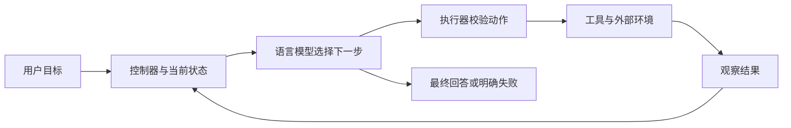

# Agent 概念与语言模型基础

[← 仓库首页](../README.md) · [本主题目录](README.md) · [下一章：经典智能体范式](02-经典智能体范式.md)

## 本章目录

- [学习目标](#学习目标)
- [从环境交互理解 Agent](#从环境交互理解-agent)
- [发展路线与知识连接](#发展路线与知识连接)
- [语言模型提供什么能力](#语言模型提供什么能力)
- [对话、工作流与 Agent 的选择](#对话工作流与-agent-的选择)
- [最小系统中的组件](#最小系统中的组件)
- [复习与练习](#复习与练习)
- [来源与延伸阅读](#来源与延伸阅读)

## 学习目标

能用任务、环境、观察、行动、反馈解释一个 Agent；能判断需求是否需要动态决策，并把模型能力与程序能力分开分析。

## 从环境交互理解 Agent

Agent 接收环境中的观察，依据目标和已有状态选择行动，再读取行动结果。对于笔记助手，环境是笔记库与工具服务，观察是检索结果，行动是检索、计算或生成回答，目标是给出可追溯的解释。



语言模型输出“已查阅笔记”并不证明发生了检索。执行器的工具记录、返回内容与来源，才是验证行动是否真实发生的依据。

用 **PEAS** 描述任务，可以在编码前固定系统边界：

| 要素 | 笔记助手中的具体定义 |
| --- | --- |
| Performance：表现标准 | 答案有依据、概念正确、遇到缺失资料能说明不足 |
| Environment：环境 | 已授权的公开 Markdown 笔记与只读检索服务 |
| Actuators：执行器 | 搜索笔记、计算、返回带引用的回答 |
| Sensors：观察入口 | 问题、工具返回值、检索片段与执行错误 |

真实环境可能只被部分观察到；检索不到某个事实，只表示本轮没取得证据。工具错误也不代表目标事实不存在。

## 发展路线与知识连接

| 路线 | 决策依据 | 学习时关注什么 |
| --- | --- | --- |
| 规则与符号系统 | 人工规则、搜索、逻辑表示 | 规则的覆盖范围与可验证性 |
| 强化学习 Agent | 状态、行动、奖励与策略 | 环境反馈、探索和长期回报 |
| LLM 驱动 Agent | 语言表示、上下文与外部工具 | 如何把模型输出转为受约束的行动 |
| 多智能体系统 | 多个角色的局部状态与协作约定 | 谁负责、如何交换信息、何时结束 |

这些路线可以组合。固定规则可约束工具参数，搜索算法可求解路径，LLM 可解释任务；选择组件取决于问题结构。

## 语言模型提供什么能力

自回归语言模型根据已有 token 预测下一个 token：

```math
P_\theta(x_{1:T})=\prod_{t=1}^{T}P_\theta(x_t\mid x_{<t})
```

这解释了它为什么能生成计划与工具参数，也解释了为什么不能直接把流畅输出视为经过验证的事实。模型通常不知道本轮工具真正执行了什么，必须通过观察结果获得信息。

- **Token 与上下文窗口**：窗口按模型 tokenizer 计量，字符数和 token 数不等价；输入、输出和协议包装均需预留空间。
- **角色与消息**：系统约束、用户目标、模型动作、工具观察要保留来源区别。外部资料不应被拼接成系统指令。
- **采样**：降低 temperature 常用于减少输出变化，仍需验证语义与格式；参数为零也不保证所有服务完全可复现。
- **结构化输出**：约束 JSON 结构便于程序解析；语法正确之后，还要验证参数范围、权限和结果真实性。
- **训练与推理**：运行时的计划、检索与反思一般不改变权重。改变权重属于[训练章节](08-AgenticRL与训练.md)的内容。

Transformer 结构可回看[语言模型基础](../5.自然语言处理/04-注意力与Transformer.md)和[推理工程](../6.Transformer与注意力/Transformer与注意力学习笔记.md)，本主题集中学习应用控制过程。

## 对话、工作流与 Agent 的选择

| 形式 | 下一步由谁确定 | 适合的笔记任务 |
| --- | --- | --- |
| 单次模型调用 | 调用方事先固定 | 改写给定段落、解释已提供公式 |
| 工作流 | 程序预设节点与分支 | 每次执行“检索 → 格式化 → 生成” |
| 动态 Agent | 模型结合观察选择行动 | 先定位知识缺口，再决定检索、计算或结束 |

动态决策适合路径难以预先穷举的任务，同时增加循环、成本与调试难度。先用简单流程完成一个基线，再用评估判断动态决策是否确有收益。

## 最小系统中的组件

| 组件 | 职责 | 配套实现 |
| --- | --- | --- |
| Model | 把消息转成下一步动作 | `Model.complete` |
| State | 保存当前任务和已发生的交互 | 消息列表与 `RunResult.trace` |
| ToolRegistry | 描述允许的工具并验证参数 | `register`、`specs`、`call` |
| Controller | 处理动作、观察、终止与失败 | `run_agent` |
| Memory / Retriever | 按需提供历史和外部证据 | `MemoryStore`、`Retriever` |

第一次运行可从[执行内核](examples/core.py)和[示例说明](examples/README.md)入手，不需要安装模型即可重放一个工具调用闭环。

## 复习与练习

1. 用 PEAS 为“根据本仓库内容回答学习问题”写一份任务定义。
2. 如果系统不接收工具结果，只在提示词中列出工具名，会缺少哪一环？
3. 为一项固定流程和一项动态任务各设计一个终止条件。


## 来源与延伸阅读

Hello Agents 对应章节：[第一章 初识智能体](https://github.com/datawhalechina/hello-agents/blob/36f583c233ea5cee4537ef93455702b55053af18/docs/chapter1/%E7%AC%AC%E4%B8%80%E7%AB%A0%20%E5%88%9D%E8%AF%86%E6%99%BA%E8%83%BD%E4%BD%93.md)；[第二章 智能体发展史](https://github.com/datawhalechina/hello-agents/blob/36f583c233ea5cee4537ef93455702b55053af18/docs/chapter2/%E7%AC%AC%E4%BA%8C%E7%AB%A0%20%E6%99%BA%E8%83%BD%E4%BD%93%E5%8F%91%E5%B1%95%E5%8F%B2.md)；[第三章 大语言模型基础](https://github.com/datawhalechina/hello-agents/blob/36f583c233ea5cee4537ef93455702b55053af18/docs/chapter3/%E7%AC%AC%E4%B8%89%E7%AB%A0%20%E5%A4%A7%E8%AF%AD%E8%A8%80%E6%A8%A1%E5%9E%8B%E5%9F%BA%E7%A1%80.md)。

本篇是围绕本仓库任务编写的学习归纳，补充实现边界与练习；上游版本、日期和完整映射见[主题目录](README.md#参考来源与整理方式)。

---

[← 仓库首页](../README.md) · [本主题目录](README.md) · [下一章：经典智能体范式](02-经典智能体范式.md)
