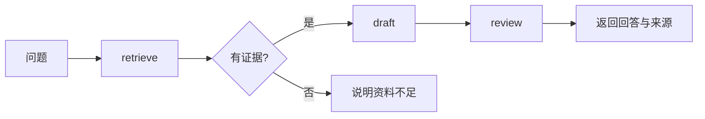

# 平台与框架的选择

[← 仓库首页](../README.md) · [本主题目录](README.md) · [上一章：经典智能体范式](02-经典智能体范式.md) · [下一章：工具调用与最小框架](04-工具调用与最小框架.md)

## 本章目录

- [学习目标](#学习目标)
- [用同一个任务比较实现方式](#用同一个任务比较实现方式)
- [低代码平台的知识逻辑](#低代码平台的知识逻辑)
- [代码框架关注的核心抽象](#代码框架关注的核心抽象)
- [如何做一次小规模选型](#如何做一次小规模选型)
- [从框架回到执行内核](#从框架回到执行内核)
- [复习与练习](#复习与练习)
- [来源与延伸阅读](#来源与延伸阅读)

## 学习目标

理解平台、框架和执行内核各自提供的能力。选型时先描述状态、控制流、工具和部署需求，再判断抽象是否合适。

## 用同一个任务比较实现方式

以“读取笔记、检索相关片段、生成解释并审查引用”为共同任务，分别回答：

1. 节点如何表达？下一步由程序分支还是模型决定？
2. 状态保存在哪里？中断后从哪个节点恢复？
3. 模型和工具调用如何查看、重放和计费？
4. 能否运行自己需要的依赖，能否导出工作流和配置？
5. 工具凭据、数据访问范围和用户隔离由哪一层管理？

使用相同任务、数据和验收标准，才能分辨平台便利性与底层模型能力的贡献。

## 低代码平台的知识逻辑

Hello Agents 使用 Coze、Dify、n8n 展示不同搭建方式。界面和套餐经常变化，学习时抓住数据流、节点契约和运行记录；具体操作按对应版本文档执行。

| 平台 | 学习重点 | 应记录的实验产物 |
| --- | --- | --- |
| [Coze](https://www.coze.cn/) | 对话入口、知识库、工具与工作流的组合 | 输入输出样例、工作流配置、运行记录 |
| [Dify](https://github.com/langgenius/dify) | 应用编排、检索节点、模型和工具配置 | 导出配置、检索参数、错误分支 |
| [n8n](https://github.com/n8n-io/n8n) | 事件触发、服务连接和自动化流程 | 触发条件、节点契约、失败恢复方式 |

可视化流程仍需遵守软件工程约束：输入有类型，输出可验证，失败有去向。把多个模型节点连起来，并不会自动获得动态任务规划能力。

## 代码框架关注的核心抽象

| 教程中的框架 | 重点观察的组织方式 | 阅读时追问 |
| --- | --- | --- |
| [AutoGen](https://github.com/microsoft/autogen) | 角色、消息和团队编排 | 消息路由、终止判定、谁持有状态？ |
| [AgentScope](https://github.com/agentscope-ai/agentscope) | Agent 组件与消息交互 | 工具、记忆与运行过程如何组合？ |
| [CAMEL](https://github.com/camel-ai/camel) | 角色扮演与协作任务 | 角色约束如何落到消息和交付物？ |
| [LangGraph](https://github.com/langchain-ai/langgraph) | 状态、节点、边与条件路由 | 状态如何更新、如何检查点恢复？ |

该表是学习抽象的入口，不是产品排名。教程与框架最新版的 API 可能不同，跟练时固定代码版本、Python 版本和依赖锁文件。

## 如何做一次小规模选型

先实现三个节点：`retrieve` 返回证据，`draft` 生成带来源的回答，`review` 验证引用存在。再增加一个分支：证据为空时返回“资料不足”。

在每一种实现中记录相同的指标：完成任务数、调用次数、延迟、失败位置、恢复步骤。平台的内置演示效果不适合作为自己任务的验收结论。

## 从框架回到执行内核

框架替你封装了部分循环、事件、持久化与观察能力。遇到异常时可以逐层定位：

| 现象 | 先检查哪一层 |
| --- | --- |
| JSON 解析失败 | 模型响应、结构约束与解析器 |
| 工具参数错 | 工具描述、Schema 与上下文证据 |
| 找不到上轮结果 | 状态写入、会话 ID 和检查点 |
| 团队对话不结束 | 路由规则、轮数预算和完成信号 |
| 换版本后无法运行 | API 变化、依赖锁与迁移说明 |

[下一章](04-工具调用与最小框架.md)用标准库实现可读的执行内核，帮助理解框架内部需要解决什么问题。它不包含框架常见的持久化、分布式调度和完整观测设施。

## 复习与练习

1. 为同一笔记问答任务画出固定工作流，再标记哪些地方值得改为动态决策。
2. 从上表选一个框架，定位它的状态定义与终止规则，记录使用的版本。
3. 故意让检索节点返回空列表，检查系统是否仍编造有来源的回答。

## 来源与延伸阅读

Hello Agents 对应章节：[第五章 基于低代码平台的智能体搭建](https://github.com/datawhalechina/hello-agents/blob/36f583c233ea5cee4537ef93455702b55053af18/docs/chapter5/%E7%AC%AC%E4%BA%94%E7%AB%A0%20%E5%9F%BA%E4%BA%8E%E4%BD%8E%E4%BB%A3%E7%A0%81%E5%B9%B3%E5%8F%B0%E7%9A%84%E6%99%BA%E8%83%BD%E4%BD%93%E6%90%AD%E5%BB%BA.md)；[第六章 框架开发实践](https://github.com/datawhalechina/hello-agents/blob/36f583c233ea5cee4537ef93455702b55053af18/docs/chapter6/%E7%AC%AC%E5%85%AD%E7%AB%A0%20%E6%A1%86%E6%9E%B6%E5%BC%80%E5%8F%91%E5%AE%9E%E8%B7%B5.md)。

本篇是围绕本仓库任务编写的学习归纳，补充实现边界与练习；上游版本、日期和完整映射见[主题目录](README.md#参考来源与整理方式)。

---

[← 仓库首页](../README.md) · [本主题目录](README.md) · [上一章：经典智能体范式](02-经典智能体范式.md) · [下一章：工具调用与最小框架](04-工具调用与最小框架.md)
