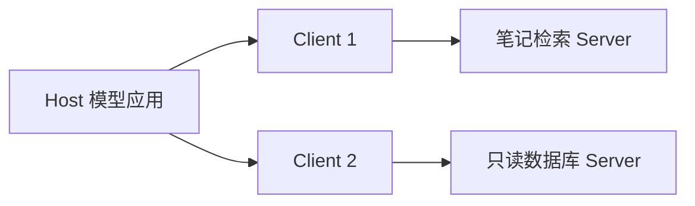

# 多智能体协作与通信协议

[← 仓库首页](../README.md) · [本主题目录](README.md) · [上一章：上下文工程](06-上下文工程.md) · [下一章：Agentic RL 与训练](08-AgenticRL与训练.md)

## 本章目录

- [学习目标](#学习目标)
- [何时拆成多个 Agent](#何时拆成多个-agent)
- [先定义消息与交付物](#先定义消息与交付物)
- [MCP：连接模型应用与工具资源](#mcp连接模型应用与工具资源)
- [A2A：跨系统的任务协作](#a2a跨系统的任务协作)
- [ANP 与开放网络探索](#anp-与开放网络探索)
- [协议之外还要设计什么](#协议之外还要设计什么)
- [复习与练习](#复习与练习)
- [来源与延伸阅读](#来源与延伸阅读)

## 学习目标

先用角色职责、消息和终止规则设计协作，再理解 MCP、A2A、ANP 解决的互操作问题。能区分协作编排、模型工具调用与通信协议。

## 何时拆成多个 Agent

多个角色适合权限、上下文或验收职责明显不同的任务。例如研究员负责取得证据，写作者负责解释，审查者负责检查支持关系。拆分依据是职责和产物，不是单纯增加模型数量。

| 协作形式 | 控制方式 | 需要额外设计的内容 |
| --- | --- | --- |
| 顺序交接 | 上一步产物成为下一步输入 | 数据契约、失败向哪返回 |
| 主管与工作者 | 主管分发任务并收集结果 | 子任务范围、汇总与冲突处理 |
| 图式协作 | 状态沿节点和条件边流转 | 状态更新与检查点 |
| 对等讨论 | 角色交换意见或协商 | 发言规则、证据要求、结束条件 |

多角色共享错误证据时可能共同得出错误结论。增加一个审查者只有在它拥有独立标准或检查能力时，才有机会提高可靠性；应通过同任务单 Agent 基线验证收益。

## 先定义消息与交付物

一个可检查的交接消息至少包含：

```json
{
  "task_id": "notes-001",
  "sender": "researcher",
  "receiver": "writer",
  "status": "completed",
  "artifact": {
    "claims": ["RAG 在生成前引入检索证据"],
    "sources": [{"id":"s1","path":"rag.md","excerpt":"先检索资料，再据此回答"}],
    "open_questions": []
  }
}
```

字段名由应用约定，该 JSON **不是 A2A 或 ANP 的线缆消息格式**。应用还应验证发送者、任务归属和产物类型，设置超时、最大交接次数与失败返回路径。

“任务已交给另一角色”是进行中状态；只有收到产物并完成验收，主管才应汇报完成。

## MCP：连接模型应用与工具资源

[MCP 官方架构](https://modelcontextprotocol.io/docs/learn/architecture)区分 Host、Client、Server：Host 管理模型应用和多个客户端；每个 Client 连接对应 Server；Server 暴露可调用工具、可读取资源和提示模板等能力。



本地进程通常可用 stdio，远端服务可用 Streamable HTTP。工具描述和调用由协议传递，模型选择哪个工具、如何组织 Agent 循环仍由应用决定。

教程和协议会持续演进：实现时固定双方支持的协议版本与 SDK 版本，并按该版本处理发现、传输、认证和结果格式。不要混用不同版本示例的握手过程。

## A2A：跨系统的任务协作

[A2A 核心概念](https://a2a-protocol.org/latest/topics/key-concepts/)关注 Agent 的能力描述、消息、任务状态与产物，使调用方可以把工作交给另一系统，并跟踪交付过程。

对学习助手而言，MCP 可以暴露 `search_notes` 工具；A2A 可以把“整理本章知识卡片”交给具有独立运行过程的专业 Agent。是否使用 LLM、如何内部规划，是被调用系统自己的实现细节。

不要把所有协作都画成无状态函数调用：长任务可能处理中断、补充输入、取消和取回结果。完成与失败状态必须进入应用的状态机。

## ANP 与开放网络探索

[Agent Network Protocol](https://github.com/agent-network-protocol/AgentNetworkProtocol)探索 Agent 身份、能力发现和开放网络中的通信协作。学习时可以把它与 MCP 的资源接入、A2A 的任务交付对照阅读。

协议能力和生态仍在变化，互通取决于具体版本与实现，不能只因两个系统都宣称支持协议，就推断所有功能可互操作。

## 协议之外还要设计什么

| 层次 | 需要应用明确的内容 |
| --- | --- |
| 模型动作 | 选哪个工具、输入什么参数、何时结束 |
| 通信协议 | 如何发现能力、传消息、传结果 |
| 协作编排 | 分工、依赖、冲突、预算和验收 |
| 访问控制 | 谁能读取哪些资料、谁能执行什么操作 |
| 可观测性 | 跨角色任务 ID、调用轨迹与失败定位 |

本仓库示例实现单进程执行器和工具注册，没有实现 MCP/A2A/ANP 客户端或服务端。对接这些协议时，应使用相应 SDK 适配工具与任务接口。

## 复习与练习

1. 设计研究员、写作者、审查者的输入输出，明确每个角色能访问哪些信息。
2. 给交接过程加入超时，说明主管如何报告“尚未取得结果”。
3. 从 `search_notes` 工具和“完成一份专题报告”任务中，分别识别工具接入与任务协作边界。


## 来源与延伸阅读

Hello Agents 对应章节：[第六章 框架开发实践](https://github.com/datawhalechina/hello-agents/blob/36f583c233ea5cee4537ef93455702b55053af18/docs/chapter6/%E7%AC%AC%E5%85%AD%E7%AB%A0%20%E6%A1%86%E6%9E%B6%E5%BC%80%E5%8F%91%E5%AE%9E%E8%B7%B5.md)；[第十章 智能体通信协议](https://github.com/datawhalechina/hello-agents/blob/36f583c233ea5cee4537ef93455702b55053af18/docs/chapter10/%E7%AC%AC%E5%8D%81%E7%AB%A0%20%E6%99%BA%E8%83%BD%E4%BD%93%E9%80%9A%E4%BF%A1%E5%8D%8F%E8%AE%AE.md)。

本篇是围绕本仓库任务编写的学习归纳，补充实现边界与练习；上游版本、日期和完整映射见[主题目录](README.md#参考来源与整理方式)。

---

[← 仓库首页](../README.md) · [本主题目录](README.md) · [上一章：上下文工程](06-上下文工程.md) · [下一章：Agentic RL 与训练](08-AgenticRL与训练.md)
