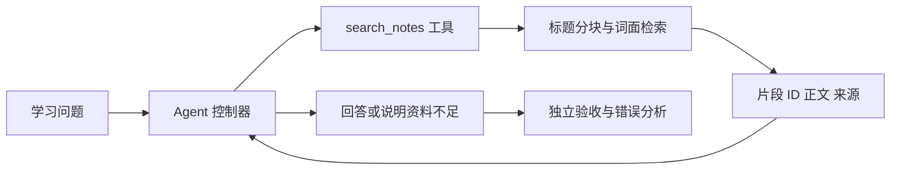

# 综合实践与毕业设计

[← 仓库首页](../README.md) · [本主题目录](README.md) · [上一章：评估、调试与可靠性](09-评估调试与可靠性.md)

## 本章目录

- [学习目标](#学习目标)
- [从上游案例抽取共通知识](#从上游案例抽取共通知识)
- [贯穿项目：仓库学习助手](#贯穿项目仓库学习助手)
- [运行第一版](#运行第一版)
- [分阶段扩展](#分阶段扩展)
- [毕业设计的交付清单](#毕业设计的交付清单)
- [复习与练习](#复习与练习)
- [来源与延伸阅读](#来源与延伸阅读)

## 学习目标

把单项机制组合成可检查、可复现的应用。先交付最小系统，再按评估结果加入动态规划、多角色与训练。

## 从上游案例抽取共通知识

| Hello Agents 案例 | 重点机制 | 迁移到笔记助手的方式 |
| --- | --- | --- |
| 智能旅行助手 | 结构化约束、多工具与角色协作 | 把学习时间、基础与目标转成计划约束 |
| 自动化深度研究 | 子问题、检索、证据整合与报告 | 将专题学习拆成可追踪的知识缺口 |
| 赛博小镇 | 角色、记忆、环境状态与事件 | 模拟老师、学生、审查者的有限交互 |
| 毕业设计 | 需求、实现、评估和文档 | 交付一个能独立运行和验收的项目 |

这些案例的共同点是“有状态的任务与真实交付物”。复现时先读数据流和核心契约，再研究界面；UI 能展示结果，不代表内部证据与任务约束已正确处理。

## 贯穿项目：仓库学习助手

目标：根据本仓库公开笔记解释知识点，附来源；在资料不足时指出缺口。第一版只读文件，不修改用户笔记。

### 输入输出契约

| 项目 | 定义 |
| --- | --- |
| 输入 | 学习问题；可选的学习目标与阅读范围 |
| 允许能力 | 检索固定公开笔记、返回来源 |
| 输出 | 概念解释或摘录、证据来源、必要的不确定性说明 |
| 完成条件 | 满足问题，来源存在且支持主要结论 |
| 失败状态 | 模型错误、轮数耗尽、检索失败、资料不足 |

### 最小数据流



[demo.py](examples/demo.py)中的 `study` 路径按二级标题切分两份新建笔记，真实执行本地检索。离线模式使用 `ExtractiveStudyPolicy`：固定先检索，再摘录首条结果；它没有调用语言模型，也不会归纳多个来源。

## 运行第一版

从仓库根目录运行：

```bash
python AI_Agent/examples/demo.py study --question "Agent 的工具与环境有什么关系？"
python AI_Agent/examples/demo.py patterns
python AI_Agent/examples/demo.py memory
python AI_Agent/examples/evaluate.py
```

要让真实模型决定动作，可在本地 Ollama 已启动、模型已安装后运行：

```bash
python AI_Agent/examples/demo.py study --live --model YOUR_LOCAL_MODEL --question "RAG 与记忆有什么区别？"
```

`YOUR_LOCAL_MODEL` 需替换为 `ollama list` 中的实际名称。真实模型模式会把问题、工具说明和检索到的公开片段发给配置的接口；默认接口在本机。具体要求和已验证范围见[代码目录说明](examples/README.md)。

## 分阶段扩展

| 阶段 | 新增能力 | 验收重点 |
| --- | --- | --- |
| 1：固定基线 | 标题分块、词面检索、来源摘录 | 文档定位正确，无重叠时说明不足 |
| 2：模型问答 | 模型选择动作与依据证据解释 | 多条证据整合、引用支持、格式恢复 |
| 3：上下文与记忆 | 用户隔离、预算与检查点 | 不串用户、关键约束不丢失、恢复可用 |
| 4：专题研究 | 子问题计划、研究与审查交接 | 依赖与来源可追踪，预算内结束 |
| 5：训练实验 | 针对稳定任务尝试 SFT / RL | 独立集改进、成本合理、无数据泄漏 |

每阶段都保留前一阶段作为基线。检索器替换、框架迁移与训练可以分别实验，便于归因。

## 毕业设计的交付清单

一个能由别人运行的学习项目应交付：

- 需求和边界：解决谁的什么问题，何种情况返回不足。
- 架构与数据契约：模型、状态、工具、检索和交付物之间如何流动。
- 环境说明：Python 与依赖版本、模型标识、启动命令、配置样例。
- 真实评估：问题集来源、成功标准、成本和失败案例。
- 复现与维护：固定数据/代码版本，明确输出和日志位置，写清已知限制。

可选题目：章节问答助手、学习路径规划器、论文与笔记证据整理助手。题目不必复杂，重点是把任务、实现、证据和评估连接完整。

## 复习与练习

1. 将 `load_notes` 扩展到指定主题目录，保持来源和公式块完整。
2. 增加 10 个真实学习问题，包括资料缺失和术语同义改写，人工标注相关片段。
3. 为研究员与审查者设计独立产物，比较单 Agent 与协作方式的质量和成本。


## 来源与延伸阅读

Hello Agents 对应章节：[第十三章 智能旅行助手](https://github.com/datawhalechina/hello-agents/blob/36f583c233ea5cee4537ef93455702b55053af18/docs/chapter13/%E7%AC%AC%E5%8D%81%E4%B8%89%E7%AB%A0%20%E6%99%BA%E8%83%BD%E6%97%85%E8%A1%8C%E5%8A%A9%E6%89%8B.md)；[第十四章 自动化深度研究智能体](https://github.com/datawhalechina/hello-agents/blob/36f583c233ea5cee4537ef93455702b55053af18/docs/chapter14/%E7%AC%AC%E5%8D%81%E5%9B%9B%E7%AB%A0%20%E8%87%AA%E5%8A%A8%E5%8C%96%E6%B7%B1%E5%BA%A6%E7%A0%94%E7%A9%B6%E6%99%BA%E8%83%BD%E4%BD%93.md)；[第十五章 构建赛博小镇](https://github.com/datawhalechina/hello-agents/blob/36f583c233ea5cee4537ef93455702b55053af18/docs/chapter15/%E7%AC%AC%E5%8D%81%E4%BA%94%E7%AB%A0%20%E6%9E%84%E5%BB%BA%E8%B5%9B%E5%8D%9A%E5%B0%8F%E9%95%87.md)；[第十六章 毕业设计](https://github.com/datawhalechina/hello-agents/blob/36f583c233ea5cee4537ef93455702b55053af18/docs/chapter16/%E7%AC%AC%E5%8D%81%E5%85%AD%E7%AB%A0%20%E6%AF%95%E4%B8%9A%E8%AE%BE%E8%AE%A1.md)。

本篇是围绕本仓库任务编写的学习归纳，补充实现边界与练习；上游版本、日期和完整映射见[主题目录](README.md#参考来源与整理方式)。

---

[← 仓库首页](../README.md) · [本主题目录](README.md) · [上一章：评估、调试与可靠性](09-评估调试与可靠性.md)
